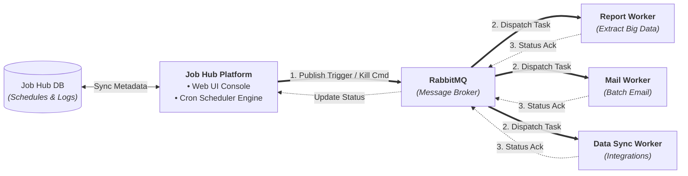

# PHILLIP
**Staff Software Engineer | Distributed Systems & Enterprise Architecture**

Ho Chi Minh City, Vietnam · [Your email] · [Your phone] · [LinkedIn URL] · [GitHub URL]

---

## EXECUTIVE SUMMARY

Staff Software Engineer with **15+ years of experience** architecting high-throughput, distributed backend systems and driving enterprise platform modernization. Proven technical leadership across the entire software lifecycle—translating ambiguous business requirements into scalable, fault-tolerant architectures. 

Deep expertise in the **.NET ecosystem (C#, ASP.NET Core, Minimal APIs), Microsoft SQL Server, RabbitMQ distributed messaging, and containerized deployments (Docker, Kubernetes)**. Strong track record of transforming legacy monolithic workflows into decoupled, configuration-driven platforms that eliminate redundant engineering overhead.

---

## CORE TECHNICAL COMPETENCIES

- **Architecture & Design:** Distributed Systems, Event-Driven Architecture (EDA), Microservices, High Availability, System Modernization, Graceful Degradation & Cancellation.
- **Backend & Frameworks:** C#, .NET 9, ASP.NET Core, Minimal APIs, RESTful Web APIs, Asynchronous Task Pipelines.
- **Messaging & Caching:** RabbitMQ (Pub/Sub, RPC Request-Reply, DLX), EasyNetQ, Memcached.
- **Data Engineering:** Microsoft SQL Server, Query & Stored Procedure Tuning, Index Optimization, Lock Scope Minimization, Large-Scale Data Extraction (5M+ rows).
- **DevOps & Infrastructure:** Docker, Kubernetes (K8s), Rancher, HAProxy, GitLab CI/CD.
- **Technical Leadership:** Architecture RFCs, Code Quality Governance, Cross-Team Dependency Resolution, Production Incident Commander.

---

## PROFESSIONAL EXPERIENCE

### Staff Software Engineer / Technical Project Lead
**Pioneers / Pionex** | *2010 – Present*

- Serve as the technical authority and system architect for core backend services; drive technology stack selection, cross-service contracts, and deployment topologies.
- Steer production incident response for mission-critical services; diagnose complex distributed race conditions and resolve high-severity issues under tight SLAs.
- Mentor senior engineers through rigorous architectural RFCs and code reviews, promoting reusable design patterns and operational excellence.

---

## KEY ARCHITECTURAL PROJECTS

### 1. Job Hub — Centralized Job Orchestration & Control Platform
*Enterprise Platform Architect & Lead Engineer | .NET 9, RabbitMQ, SQL Server, ReactJS, Docker*

- **Problem:** Fragmented background jobs across multiple teams led to resource contention, redundant database queries, untracked zombie processes, and zero capability to abort hung tasks without container restarts.
- **Architecture:** Architected a decoupled Control Plane and Data Plane model. Job Hub manages schedules, states, and audit trails; RabbitMQ mediates asynchronous work distribution via Topic exchanges; Worker nodes execute tasks and support dynamic runtime intervention via RPC Request-Reply.
- **Impact:** Unified all background batch operations across teams; enabled **sub-second process termination** via cooperative `CancellationToken` (with clean DB rollback); eliminated query collisions and reclaimed significant database server CPU/memory.

---

### 2. Customer Setting Modernization Platform
*Technical Project Lead | .NET 9 Minimal API, ReactJS, SQL Server, Docker*

- **Problem:** Over 20 product integrations relied on copy-pasting and cloning configuration code, creating massive technical debt, high maintenance overhead, and frequent integration regressions.
- **Architecture:** Re-architected fragmented workflows into a centralized, **configuration-driven engine**. Narrowed database locking granularity in User Maintenance (UM) to specific sub-domains rather than locking the entire system. Automated setting initialization to remove error-prone manual SQL scripts.
- **Impact:** Slashed new product onboarding time from weeks to hours; eliminated 20+ duplicate codebases; consolidated RNG Casino settings into the shared DCS architecture with zero downtime.

---

### 3. Large-Scale Report Extraction Engine
*Backend Architect & Core Contributor | .NET, Asynchronous Task Queue, SQL Server, EPPlus*

- **Problem:** Synchronous export requests of multi-year analytical datasets (up to 5 million records) caused thread pool starvation, web server HTTP 504 timeouts, and heavy table locks on production transactional databases.
- **Architecture:** Isolated report workloads by introducing an asynchronous queue-backed execution pipeline with pagination chunking and streaming file serialization. Implemented administrator cancellation hooks to terminate long-running extraction queries safely.
- **Impact:** Successfully processed **5,000,000+ record datasets across 3-year date ranges** with 0% impact on interactive web user requests.

---

### 4. Mail Station & Cash Service Product Integrations
*Key Backend Contributor | .NET, RabbitMQ, EasyNetQ, SQL Server, HAProxy*

- Built a centralized, high-throughput email processing station on clustered RabbitMQ with database-backed caching (Memcached).
- Delivered backend integrations for Cash Service, NAP, External Admin, and vendor platform migrations (Saba Club $\to$ Saba Play, Vertex Play) under strict financial data consistency guarantees.

---

## EDUCATION

**Bachelor of Science in Computer Science / Information Technology**  
[University Name] · [Graduation Year]
